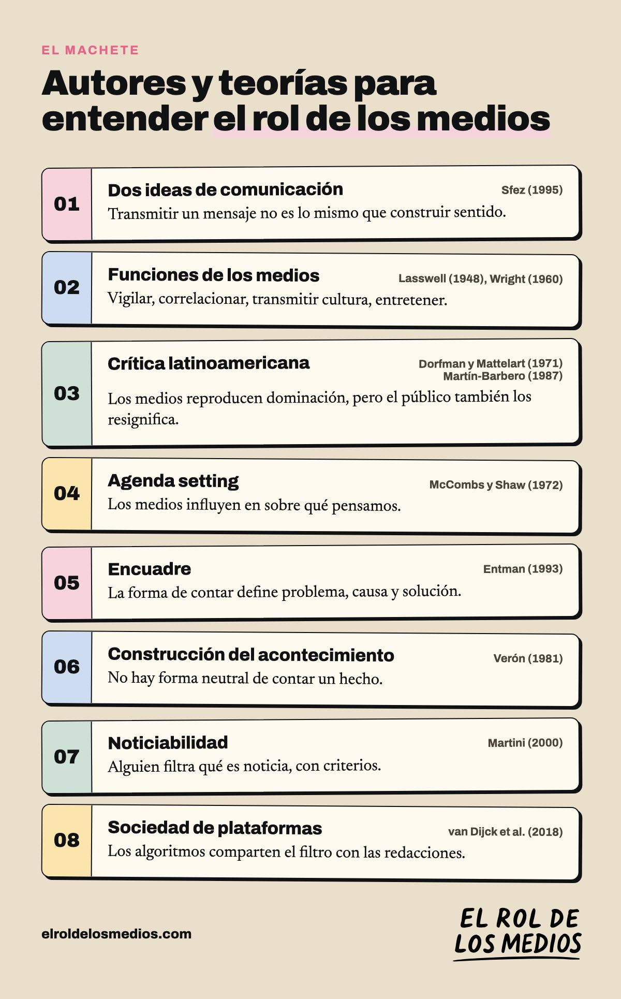

Se suele decir que el rol de los medios de comunicación es informar. Es cierto, pero se queda corto. Antes de informar, alguien decidió qué era noticia, desde qué ángulo contarla y qué dejar afuera. Esas decisiones, repetidas todos los días, terminan influyendo en qué temas discute una sociedad y en cómo los piensa.

## ¿Qué son los medios de comunicación?

Los medios de comunicación son las organizaciones y tecnologías que producen mensajes y los hacen llegar a públicos amplios. Los tradicionales son la prensa escrita, la radio y la televisión; a ellos se sumaron los portales de noticias y, más recientemente, las plataformas digitales y las redes sociales. Los canales de streaming muestran que esos límites se corren: no son exactamente una radio ni un canal de televisión, sino algo en el medio. Lo que define a un medio no es el soporte, sino su función de intermediario: casi todo lo que sabemos de lo que pasa fuera de nuestro entorno inmediato nos llega a través de ellos.

Pensarlos como simples "transmisores" de información depende de una idea de la comunicación. Lucien Sfez (1995) distingue dos. En la concepción **representativa**, la comunicación funciona como una bola de billar: un emisor golpea, el mensaje viaja por un canal y llega al receptor; todo lo que se interpone es ruido que hay que eliminar. En la concepción **expresiva**, en cambio, emisor, mensaje y receptor no están separados: el sentido se arma dentro de un mundo compartido y nadie lo controla del todo. Buena parte de lo que sigue muestra por qué la imagen de la bola de billar no alcanza para explicar a los medios.

## ¿Qué funciones cumplen los medios de comunicación?

Las funciones clásicas de los medios son vigilar el entorno, relacionar a las partes de la sociedad entre sí, transmitir la cultura y entretener. Las tres primeras las propuso Harold Lasswell en 1948; la cuarta la agregó Charles Wright en 1960.

- **Vigilancia del entorno:** avisar qué está pasando, sobre todo lo que puede afectarnos (una crisis, una elección, una catástrofe).
- **Correlación:** interpretar esos hechos y ponerlos en relación, para que una sociedad pueda reaccionar ante ellos.
- **Transmisión cultural:** hacer circular valores, normas y saberes de una generación a otra.
- **Entretenimiento:** ofrecer distracción y disfrute, que también moldea gustos y formas de ver el mundo.

Esta mirada, conocida como funcionalista, describe bien para qué sirven los medios, pero dice poco sobre el poder que tienen al elegir.

## ¿Por qué se dice que los medios son el "cuarto poder"?

Porque se espera que controlen a los otros tres poderes del Estado: que investiguen, expongan abusos y obliguen a los gobernantes a rendir cuentas. El ejemplo clásico es Watergate: entre 1972 y 1974, las investigaciones de *The Washington Post* contribuyeron a la renuncia del presidente estadounidense Richard Nixon.

La expresión tiene una trampa. Los medios también son empresas, con dueños, anunciantes e intereses políticos propios, y quién los financia importa: no es lo mismo un medio que vive de la publicidad que uno que se sostiene con aportes de su audiencia. Por eso la pregunta no es solo a quién controlan, sino quién los controla a ellos.

## ¿Qué se le criticó a esta mirada desde América Latina?

Que describía para qué sirven los medios sin preguntar a quién sirven. En los años setenta, investigadores latinoamericanos retomaron de la Escuela de Frankfurt el concepto de **industria cultural**: la cultura producida en serie, como una mercancía más. En Chile, Ariel Dorfman y Armand Mattelart (1971) mostraron en *Para leer al Pato Donald* que hasta una historieta infantil podía transmitir una visión del mundo en la que los pueblos de los países periféricos aparecían como "buenos salvajes", ingenuos y atrasados.

En los años ochenta, Jesús Martín-Barbero (1987) propuso un giro: pasar "de los medios a las mediaciones". El público no es una masa pasiva que absorbe mensajes. Los lee desde su cultura, su vida cotidiana y sus gustos, y a veces los resiste o los usa a su manera. Esa idea atraviesa todo lo que sigue: los medios tienen poder, pero no un poder absoluto.

## ¿Los medios nos dicen qué pensar?

No exactamente: los medios influyen menos en qué pensamos que en sobre qué pensamos. A principios del siglo XX se creía lo contrario. La llamada teoría de la **aguja hipodérmica** imaginaba que los mensajes se "inyectaban" en una audiencia indefensa. En los años cuarenta, los estudios sobre campañas electorales en Estados Unidos mostraron otra cosa: los mensajes pasaban por la familia, los amigos y los líderes de opinión, y más que cambiar ideas, reforzaban las que la gente ya tenía.

Maxwell McCombs y Donald Shaw (1972) encontraron dónde estaba el poder de los medios. Durante la campaña presidencial de 1968 en Estados Unidos, compararon los temas que más destacaban los medios con los que los votantes indecisos de Chapel Hill consideraban más importantes, y encontraron una correspondencia muy alta. Así nació la teoría de la **agenda setting**: lo que los medios repiten y ubican en primer plano tiende a volverse lo importante para el público.

Con el tiempo, la teoría sumó un **segundo nivel**: los medios no solo instalan temas, también los atributos con los que pensamos esos temas. No es lo mismo que se hable mucho de la inflación que se hable de ella como "culpa del gobierno" o como "crisis global". Natalia Aruguete (2015) revisó estos desarrollos y sus discusiones desde la Argentina.

## ¿Cómo influye la forma de contar una noticia?

Influye tanto como la elección del tema. Robert Entman (1993) llamó **encuadre** (*framing*) a la operación de seleccionar algunos aspectos de un hecho y volverlos más visibles, de modo de proponer una definición del problema, una causa, un juicio moral y una solución.

Un mismo corte de calle puede contarse como un caos de tránsito que perjudica a quienes van a trabajar o como un reclamo salarial que no encuentra respuesta. Los hechos son los mismos; el encuadre cambia quién aparece como responsable y qué se espera que haga el lector.

## ¿Los medios reflejan la realidad o la construyen?

La construyen, al menos en parte. Para Eliseo Verón (1981/1987), los acontecimientos sociales no nos llegan como objetos ya hechos: existen para nosotros en la medida en que los discursos de los medios les dan forma. Verón lo mostró analizando cómo la prensa francesa cubrió el accidente nuclear de Three Mile Island, en 1979: cada medio construyó un acontecimiento distinto a partir del mismo hecho.

Esto no significa que los medios inventen la realidad. Significa que no hay una forma neutral de contarla: toda cobertura implica elegir fuentes, palabras, imágenes y un orden.

## ¿Qué cambió con las redes sociales y las plataformas?

Cambió quién decide qué se ve. Durante buena parte del siglo XX, ese filtro estaba sobre todo en las redacciones, y tiene nombre: **gatekeeping**. Stella Martini (2000) sistematizó los **criterios de noticiabilidad** que guían esa selección, como la novedad, la gravedad, la proximidad o la jerarquía de los protagonistas.

Hoy las redacciones comparten ese filtro con las plataformas digitales y sus algoritmos, que ordenan lo que cada persona ve según métricas de interacción. José van Dijck, Thomas Poell y Martijn de Waal (2018) describen este escenario como una **sociedad de plataformas**, en la que empresas como Google, Meta o TikTok organizan buena parte de la circulación pública de la información.

En las redes, el encuadre tampoco depende solo de la línea editorial de un medio. Ernesto Calvo y Natalia Aruguete (2020) mostraron que los usuarios comparten sobre todo lo que confirma lo que ya creen, y así cada comunidad arma su propio encuadre de un mismo hecho.

Eso abre nuevas tensiones. Un contenido puede tener muchísima visibilidad sin tener credibilidad (lo analizamos con dos casos reales en [Sancor vs. Toyota: visibilidad y credibilidad](/blog/sancor-toyota-visibilidad-credibilidad/)), y una comunidad pequeña pero fiel puede pesar más que una audiencia enorme y dispersa. El rol de los medios ya no se juega solo en lo que publican, sino en cómo compiten por atención dentro de reglas que no controlan.

## ¿Cómo se puede trabajar este tema en clase?

Además de leer a los autores, sirve ponerlos en situación. Una propuesta es pedir que dos grupos cubran el mismo hecho con encuadres distintos y después comparar qué cambió.

Otra es usar un juego. Los *newsgames*, juegos que retoman convenciones periodísticas para hablar de la actualidad, ya tienen ejemplos argentinos: Mariano Mancuso y Diego Maté (2023) analizaron dos y mostraron que perder una partida puede ser una forma de cuestionar las noticias.

En *El Rol de los Medios*, un juego de cartas pensado para el aula, cada jugador asume el lugar de un actor del ecosistema y tiene que decidir qué publicar, qué amplificar y a quién enfrentar, mientras equilibra tres métricas: **credibilidad, visibilidad y comunidad**. La agenda, el encuadre y la lógica de las plataformas dejan de ser conceptos para convertirse en decisiones con consecuencias.

Entre abril y mayo de 2026 hicimos una encuesta sobre el juego: respondieron 71 personas, 55 de ellas de la UBA. En promedio, calificaron su potencial educativo con un 8 sobre 10, y 54 de las 71 dijeron que lo usarían para abrir un debate después de leer un texto teórico.

Si te interesa por qué un juego de cartas ayuda a entender estos conceptos, leé [Juegos de cartas para enseñar medios en la universidad: ventajas](/blog/ventajas-juegos-de-cartas-medios/). Y si querés conocer el juego, podés [pre-registrarte en la página principal](https://elroldelosmedios.com/#conseguir) o [probar el contador de puntos](https://elroldelosmedios.com/contador).

## ¿Qué autores y teorías hay que conocer?

| Teoría o concepto | Autor y año | Idea clave |
|---|---|---|
| Dos ideas de comunicación | Sfez (1995) | Transmitir un mensaje no es lo mismo que construir sentido |
| Funciones de los medios | Lasswell (1948), Wright (1960) | Vigilar, correlacionar, transmitir cultura, entretener |
| Crítica latinoamericana | Dorfman y Mattelart (1971), Martín-Barbero (1987) | Los medios reproducen dominación, pero el público también los resignifica |
| Agenda setting | McCombs y Shaw (1972) | Los medios influyen en sobre qué pensamos |
| Encuadre | Entman (1993) | La forma de contar define problema, causa y solución |
| Construcción del acontecimiento | Verón (1981) | No hay forma neutral de contar un hecho |
| Noticiabilidad | Martini (2000) | Alguien filtra qué es noticia, con criterios |
| Sociedad de plataformas | van Dijck et al. (2018) | Los algoritmos comparten el filtro con las redacciones |

## Referencias

- Aruguete, N. (2015). *El poder de la agenda: Política, medios y público*. Biblos.
- Calvo, E. y Aruguete, N. (2020). *Fake news, trolls y otros encantos: Cómo funcionan (para bien y para mal) las redes sociales*. Siglo XXI.
- Dorfman, A. y Mattelart, A. (1973). *Para leer al Pato Donald: Comunicación de masa y colonialismo*. Siglo XXI. (Trabajo original publicado en 1971)
- Entman, R. M. (1993). Framing: Toward clarification of a fractured paradigm. *Journal of Communication, 43*(4), 51–58. [https://doi.org/10.1111/j.1460-2466.1993.tb01304.x](https://doi.org/10.1111/j.1460-2466.1993.tb01304.x)
- Lasswell, H. D. (1948). The structure and function of communication in society. En L. Bryson (Ed.), *The communication of ideas* (pp. 37–51). Harper and Brothers.
- Mancuso, M. y Maté, D. (2023). Lecciones de la derrota: Análisis de dos newsgames de Argentina. *Contratexto*, (39), 165–183. [https://doi.org/10.26439/contratexto2023.n39.6157](https://doi.org/10.26439/contratexto2023.n39.6157)
- Martín-Barbero, J. (1987). *De los medios a las mediaciones: Comunicación, cultura y hegemonía*. Gustavo Gili.
- Martini, S. (2000). *Periodismo, noticia y noticiabilidad*. Norma.
- McCombs, M. E. y Shaw, D. L. (1972). The agenda-setting function of mass media. *Public Opinion Quarterly, 36*(2), 176–187. [https://doi.org/10.1086/267990](https://doi.org/10.1086/267990)
- Sfez, L. (1995). *Crítica de la comunicación*. Amorrortu.
- Van Dijck, J., Poell, T. y de Waal, M. (2018). *The platform society: Public values in a connective world*. Oxford University Press.
- Verón, E. (1987). *Construir el acontecimiento: Los medios de comunicación masiva y el accidente en la central nuclear de Three Mile Island*. Gedisa. (Trabajo original publicado en 1981)
- Wright, C. R. (1960). Functional analysis and mass communication. *Public Opinion Quarterly, 24*(4), 605–620. [https://doi.org/10.1086/266976](https://doi.org/10.1086/266976)
